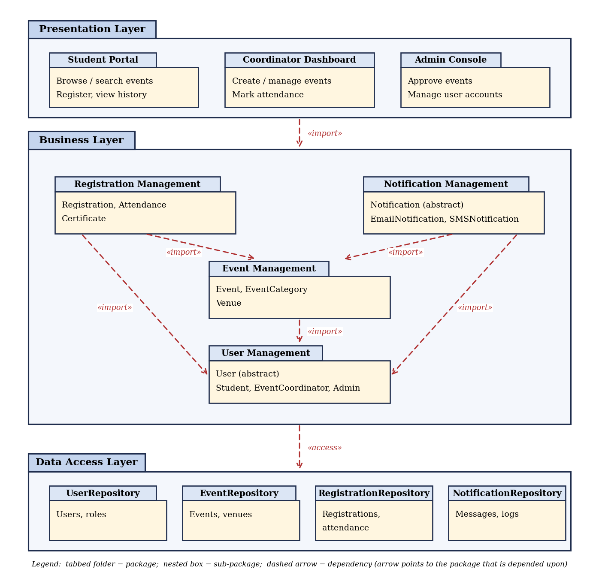

# Practical No. 6 — UML Package Diagram

**Course:** LAB: Software Engineering (23CT1704)
**Case Study:** Extra-Curricular Event Tracking System (ECETS)

## Aim
To study and draw UML Package diagram for Extra-Curricular Event Tracking System.

## Case Study
Students register for events published by event coordinators, with attendance,
certificates and notifications handled by the system. The classes identified in
Practical 5 are grouped into packages and arranged in three architectural layers.

## Layers and Packages

| Package | Contents / Responsibility |
|---|---|
| Presentation Layer | Student Portal (browse/search events, register, view history), Coordinator Dashboard (create/manage events, mark attendance), Admin Console (approve events, manage user accounts) |
| Business Layer | Core logic of the system, divided into the four packages below |
| User Management | User (abstract), Student, EventCoordinator, Admin |
| Event Management | Event, EventCategory, Venue |
| Registration Management | Registration, Attendance, Certificate |
| Notification Management | Notification (abstract), EmailNotification, SMSNotification |
| Data Access Layer | UserRepository, EventRepository, RegistrationRepository, NotificationRepository - persistence of system data |

## Dependencies Between Packages

| From | To | Stereotype / Reason |
|---|---|---|
| Presentation Layer | Business Layer | `<<import>>` - user interfaces invoke business services |
| Business Layer | Data Access Layer | `<<access>>` - business logic reads and stores data |
| Registration Management | User Management | `<<import>>` - registrations are submitted by students |
| Registration Management | Event Management | `<<import>>` - registrations are made for events with limited seats |
| Event Management | User Management | `<<import>>` - events are created by coordinators and approved by admins |
| Notification Management | Event Management | `<<import>>` - notifications are triggered by event changes |
| Notification Management | User Management | `<<import>>` - messages are addressed to users |

## Diagram

*Fig 6.1: UML Package Diagram - Extra-Curricular Event Tracking System*

The dependencies form no cycles, so the architecture is strictly layered.

## Outcome
Studied the concepts of UML Package Diagrams and drew an appropriate Package
Diagram for the Extra-Curricular Event Tracking System, organising its classes
into packages and layers and showing the dependencies between them.
